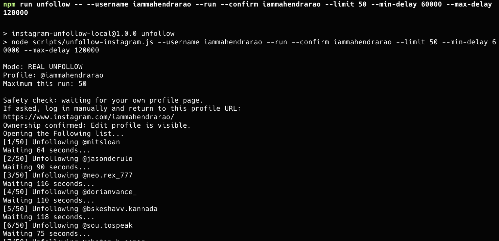
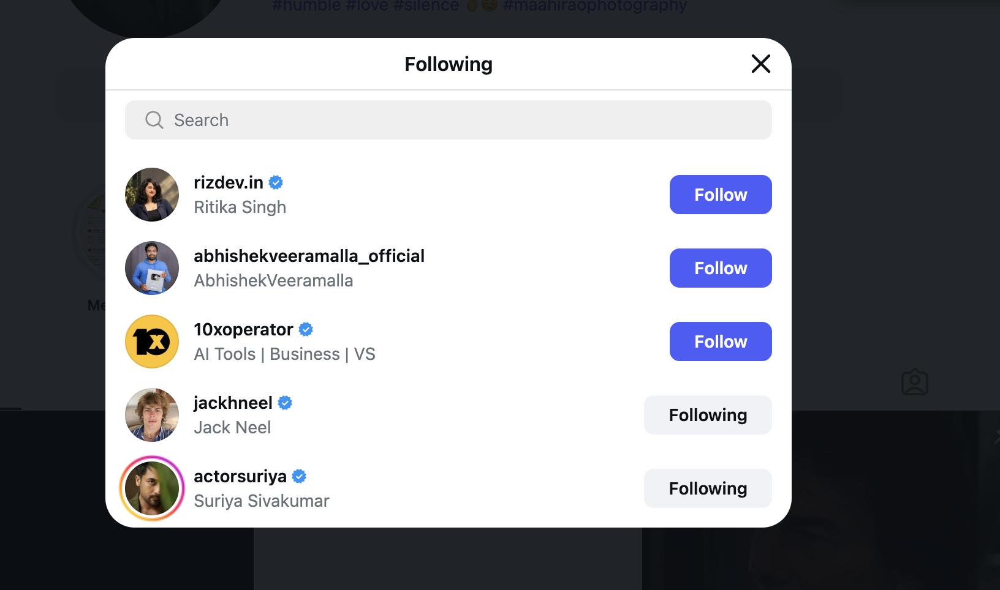

# Instagram Following Cleanup

A cautious, local Playwright utility for unfollowing accounts from your own
Instagram **Following** list in small, rate-limited batches.



## Why this project exists

Following thousands of accounts manually can leave an Instagram feed noisy and
difficult to manage. Instagram's web interface supports unfollowing one account
at a time, but repeating the same interaction across a large list is tedious.

This project automates that existing browser interaction. It opens the logged-in
user's own profile, verifies ownership, opens the Following dialog, and clicks
Instagram's normal **Following** and **Unfollow** controls. It does not use a
private API, collect passwords, remove followers, or bypass account challenges.

## What it does

- Runs locally in a visible Google Chrome window.
- Stores the browser session only in a local ignored directory.
- Confirms that **Edit profile** is visible before taking action.
- Supports a no-change dry-run preview.
- Requires an explicit username confirmation for real unfollows.
- Adds a random delay between actions.
- Limits each run to a maximum of 50 accounts.

## What it does not do

- It does not remove or unfollow your followers.
- It does not decide which accounts are important.
- It does not bypass login, 2FA, captchas, challenges, or action limits.
- It does not guarantee protection from Instagram restrictions.
- It is not affiliated with Instagram or Meta.

Every account encountered in the Following list is eligible to be unfollowed.
If you need to preserve specific accounts, do not run the tool until an allowlist
feature has been added.

## Requirements

- macOS, Linux, or Windows
- Node.js 20 or newer
- Google Chrome
- An Instagram account that you own

## Installation

```bash
git clone https://github.com/MahendraRao/instagram-following-cleanup.git
cd instagram-following-cleanup
npm install
```

## Preview without making changes

```bash
npm run unfollow -- --username YOUR_INSTAGRAM_USERNAME --limit 10
```

The first run opens a separate Chrome window. Log in manually if Instagram asks,
then return to your own profile. The session is saved locally in
`.ig-browser-data/` and is excluded from Git.

## Run a small cleanup batch

```bash
npm run unfollow -- \
  --username YOUR_INSTAGRAM_USERNAME \
  --run \
  --confirm YOUR_INSTAGRAM_USERNAME \
  --limit 10 \
  --min-delay 60000 \
  --max-delay 120000
```

For a longer batch, change `--limit 10` to `--limit 50`. With the default delay
range, 50 actions take roughly 50 to 100 minutes.

Press `Control+C` at any time to stop.

## Command options

| Option | Description | Default |
| --- | --- | --- |
| `--username <name>` | Instagram profile to verify and open | Required |
| `--run` | Enables real unfollow actions | Dry run |
| `--confirm <name>` | Must exactly match `--username` in run mode | Required in run mode |
| `--limit <1-50>` | Maximum accounts processed in one run | `10` |
| `--min-delay <ms>` | Minimum delay after each action | `60000` |
| `--max-delay <ms>` | Maximum delay after each action | `120000` |
| `--row-timeout <ms>` | Maximum wait for Instagram to load another row | `90000` |
| `--profile-dir <path>` | Local browser-session directory | `.ig-browser-data` |

## How it works



1. Playwright launches Google Chrome with a dedicated local profile.
2. The script navigates to the username supplied on the command line.
3. It verifies the profile is owned by the logged-in user by finding
   **Edit profile**.
4. It opens the Following dialog using visible text or link semantics.
5. In dry-run mode, it reports accounts without clicking anything.
6. In run mode, it clicks **Following**, confirms **Unfollow**, and waits for a
   randomized interval before continuing.

Instagram changes its interface periodically. Selectors may need maintenance if
the dialog or button labels change.

The dialog shell can appear before Instagram finishes loading its rows. The tool
waits up to 90 seconds for an actionable row and reacquires the dialog whenever
Instagram replaces it. A loading failure is reported as an error instead of a
misleading successful `0 account(s) unfollowed` result.

## Safety and privacy

Automating account actions can violate platform rules or trigger temporary
restrictions. Use small batches, wait between runs, and stop immediately if
Instagram displays a warning or challenge. You are responsible for how you use
the tool.

Never commit `.ig-browser-data/`. It can contain cookies and authenticated
browser state. The directory is already included in `.gitignore`.

The documentation screenshots are real examples supplied by the project author
and may show public Instagram handles.

## Project story

For the design rationale, implementation decisions, and lessons learned, read
[Building a Safer Local Instagram Following Cleanup Tool](ARTICLE.md).

## License

[MIT](LICENSE)
